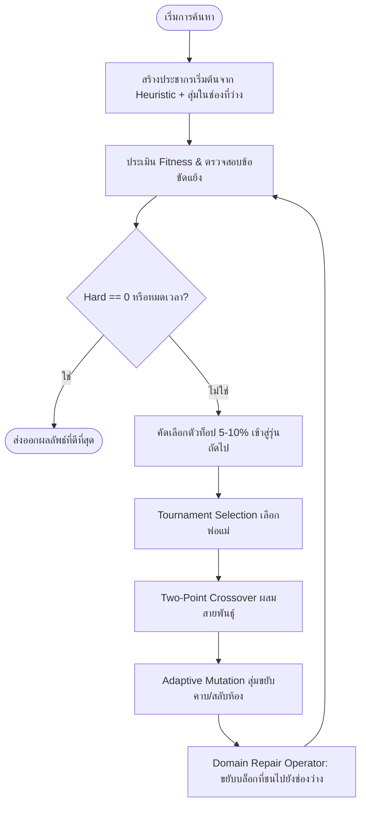

# DEVELOPMENT_PLAN.md — แผนแม่บทระบบจัดตารางเรียนตารางสอนอัจฉริยะ (Learning Table V2)

> **โครงการ:** เว็บแอปพลิเคชันระบบจัดตารางเรียนตารางสอนสำหรับการแข่งขันทักษะวิชาชีพ AI ระดับ ปวส. “ระดับภาค”  
> **คะแนนในขอบเขตการพัฒนา:** 85 คะแนน (ไม่รวมงานนำเสนอ/สไลด์ 15 คะแนน)  
> **สถานะปัจจุบัน:** ร่างแผนฉบับสมบูรณ์ (รอการอนุมัติก่อนเริ่มพัฒนาแต่ละระยะ)  
> **เทคโนโลยีหลัก:** Next.js (App Router, Node.js runtime, Route Handlers) + TypeScript + TailwindCSS + Firebase Auth + Cloud Firestore + Netlify Deploy + Vitest

---

## สารบัญ
1. [การตรวจสอบข้อมูลและข้อจำกัดเบื้องต้น (Pre-Flight Checks)](#1-การตรวจสอบข้อมูลและข้อจำกัดเบื้องต้น)
2. [การแนะนำอัลกอริทึม 3 รูปแบบเพื่อพิจารณา](#2-การแนะนำอัลกอริทึม-3-รูปแบบเพื่อพิจารณา)
3. [Gap Analysis ของโปรเจกต์เดิม](#3-gap-analysis-ของโปรเจกต์เดิม)
4. [ตารางตรวจสอบเกณฑ์การให้คะแนน (85 คะแนน)](#4-ตารางตรวจสอบเกณฑ์การให้คะแนน-85-คะแนน)
5. [สถาปัตยกรรมระบบ, Firestore Schema, Indexes, Rules และโครงสร้างไฟล์](#5-สถาปัตยกรรมระบบ-firestore-schema-indexes-rules-และโครงสร้างไฟล์)
6. [การออกแบบ Engine, Genetic Algorithm (GA) และ Scheduling Agent](#6-การออกแบบ-engine-genetic-algorithm-ga-และ-scheduling-agent)
7. [แผนงานย่อย ลำดับการพัฒนา (Phase A–D) และ Acceptance Criteria](#7-แผนงานย่อย-ลำดับการพัฒนา-phase-ad-และ-acceptance-criteria)
8. [แผนการทดสอบ (Normal, Edge, Infeasible Proof, Stress)](#8-แผนการทดสอบ-normal-edge-infeasible-proof-stress)
9. [แผน Deployment, ความเสี่ยง และวิธีรันสำรองบนเครื่อง (Fallback Execution)](#9-แผน-deployment-ความเสี่ยง-และวิธีรันสำรองบนเครื่อง)

---

## 1. การตรวจสอบข้อมูลและข้อจำกัดเบื้องต้น

จากการสำรวจ workspace ปัจจุบัน (`c:\Users\Pc\Desktop\lerning_tableV2`) และ codebase เดิม (`..\learning_time\Learning_Table`):
1. **ข้อมูลนำเข้าจริง (CSV):** ได้รับข้อมูลโครงสร้างจริงของ แผนกวิชาเทคโนโลยีสารสนเทศและการสื่อสาร วิทยาลัยเทคนิคระยอง ภาคเรียน 2/2569 ครบถ้วน (บันทึกไว้ที่ `raw_data.csv`) มีทั้งระดับ ปวช.1–3 (เรียนรวม 2 กลุ่ม) และ ปวส.1–2 (เรียนแยกห้อง), การคำนวณภาระงานสอน, เกณฑ์ชั่วโมงสอน, รายชื่อครู 10 ท่าน และตารางสอนตัวอย่างของ อ.ปริญญา จำเนียรพล
2. **Firebase Configuration:** ตรวจพบการตั้งค่าโปรเจกต์ Firebase ในระบบเดิม (`learning-time-2dba3`) โดยเก็บไว้ใน `.env.local` และมีแม่แบบใน `.env.example` ตรงตามหลักความปลอดภัย (ไม่มีการ Hardcode Key ใน Repository)
3. **การอ่านไฟล์และสถานะโค้ดเดิม:** โค้ดต้นฉบับมี Unit Tests 19 ไฟล์ รวม 173 tests ผ่านทั้งหมด 100% แต่ยังมี Gap ด้าน UI/UX ความสมบูรณ์ของฟอร์มตารางสอนแบบทางการตามตัวอย่างจริง และการคอนฟิก Netlify สำหรับ deploy

---

## 2. การแนะนำและออกแบบอัลกอริทึมทั้ง 3 รูปแบบให้ผู้ใช้เลือก (User-Selectable Multi-Algorithm System)

เพื่อให้ผู้ใช้งาน (ทั้งอาจารย์ผู้จัดตารางและคณะกรรมการผู้ตัดสิน) สามารถเลือกใช้งานอัลกอริทึมได้ตามสถานการณ์และความต้องการ ระบบจะเปิดให้ผู้ใช้เลือกได้ **ทั้ง 3 อัลกอริทึมหลัก** พร้อม **โหมด Scheduling Agent (AI อัตโนมัติ)** โดยมี **การ์ดคำอธิบายประกอบ (Interactive Algorithm Explanation Cards)** ในหน้าจอ UI เพื่อให้ผู้ใช้เข้าใจหลักการ ความเหมาะสม และข้อดีได้อย่างชัดเจน:

### 2.1 ตารางเปรียบเทียบอัลกอริทึมทั้ง 3 แบบ + โหมด Agent

| มิติเปรียบเทียบ | 1. Greedy Heuristic (MRV) | 2. Genetic Algorithm (GA) | 3. Conflict-Driven Tabu Search | [โหมดเสริม] Scheduling Agent |
|---|---|---|---|---|
| **แท็กสถานะ UI** | ⚡ *เร็วที่สุด (< 50ms)* | 🏆 *สมดุลและคุณภาพสูงสุด* | 🎯 *แก้ชนตรงจุด (< 1s)* | 🤖 *ระบบอัตโนมัติ (AI-Guided)* |
| **หลักการทำงาน** | เรียงลำดับวิชาที่มีเงื่อนไขยากสุดก่อน (Most-Constrained-First) แล้ววางลงช่องว่างแรกที่ไม่มีข้อขัดแย้ง | วิวัฒนาการประชากรตารางผ่าน Crossover, Mutation, Elitism และมี **Domain Repair Operator** ย้ายคาบชนเข้าช่องว่าง | เริ่มจากตารางร่าง ตรวจหาเฉพาะคาบที่มี Hard Violation แล้วสลับ/ย้ายจุดที่มีปัญหาโดยใช้ **Tabu List** ป้องกันการวนลูป | กำกับ GA โดยอัตโนมัติ: วิเคราะห์ความหนาแน่น → ตั้งค่า GA → รัน → ตรวจสอบ → ปรับจูนค้นหาซ้ำ |
| **ความเหมาะสม (Best Suited For)** | • โจทย์ขนาดเล็ก–กลาง<br>• ตารางที่ความหนาแน่นต่ำ<br>• ต้องการผลลัพธ์ทันทีเพื่อดูภาพรวมเบื้องต้น<br>• ใช้เป็น **Baseline** เปรียบเทียบ | • โจทย์จริงระดับมาตรฐานถึงซับซ้อนสูง (เช่น มีวิชาเรียนรวมและแยกห้องพร้อมกัน)<br>• ต้องการเกลี่ยภาระสอนและลดคาบว่าง (Soft Score สูง) | • โจทย์ที่มีความหนาแน่นสูงและเกิด Hard Conflict เฉพาะจุด<br>• ต้องการขจัดข้อขัดแย้ง (Hard = 0) ในเวลาสั้นที่สุด<br>• ทรัพยากรเครื่องมีจำกัด | • ผู้ใช้ทั่วไปที่ไม่ต้องการปรับจูนค่าพารามิเตอร์เอง<br>• ต้องการหลักฐานและบันทึกเหตุผลการตัดสินใจภาษาไทย |
| **ข้อดี (Advantages)** | 1. ทำงานเร็วที่สุดในระดับเสี้ยววินาที<br>2. ผลลัพธ์คงที่แน่นอน 100% (Deterministic)<br>3. ไม่กิน CPU/RAM ของเบราว์เซอร์ | 1. ค้นหาได้ครอบคลุมทั่ว Search Space<br>2. ปรับแต่งน้ำหนัก Soft Constraints ได้อิสระ<br>3. Repair Operator ซ่อมจุดชนได้แม่นยำ | 1. พุ่งเป้าแก้เฉพาะจุดที่ชน ไม่เสียเวลาคำนวณยีนที่ไม่ขัดแย้ง<br>2. ล้าง Hard Conflict ได้เร็วมาก<br>3. ใช้หน่วยความจำต่ำมาก | 1. ปรับพารามิเตอร์ตามพฤติกรรมข้อมูลจริง<br>2. มี Log อธิบายการปรับจูนโปร่งใส<br>3. รองรับการฟื้นตัวจากการติดหล่ม |
| **จุดพิจารณา / ข้อจำกัด** | ติดหล่ม Local Optima ได้ง่ายหากตารางชนกันแน่น และไม่สามารถเกลี่ย Soft Constraints ได้ดี | ใช้เวลาประมวลผล 1–5 วินาที ขึ้นกับขนาดประชากรและจำนวนรุ่น | เน้นล้างข้อขัดแย้ง Hard เป็นหลัก การเกลี่ย Soft ในภาพรวมอาจด้อยกว่า GA เล็กน้อย | ใช้เวลาค้นหาหลายรอบตามงบเวลาที่ตั้งไว้ |
| **เวลาคำนวณเฉลี่ย** | **10 – 50 ms** | **1 – 5 วินาที** | **100 – 800 ms** | **3 – 10 วินาที** |

---

### 2.3 [ฟังก์ชันเสริมพิเศษ] Hybrid AI: Gemini API สำหรับ AI Scheduling Copilot & Advisor

เพื่อเพิ่มคะแนนด้านนวัตกรรม (Innovation & Completeness) นอกเหนือจาก Rule-based Agent ที่เป็นไปตามเกณฑ์แข่งขัน ระบบจะมีส่วนเสริม **AI Copilot (ขับเคลื่อนด้วย Google Gemini API / fallback สู่ Rule-based ในเครื่องเมื่อออฟไลน์)**:
- **AI Strategic Insights:** วิเคราะห์คุณภาพตารางสอนและให้คำแนะนำเชิงบริหารเป็นภาษาไทยสละสลวย
- **Executive Summary Generator:** สรุปภาพรวมและภาระงานครูเพื่อแนบรายงานเสนอผู้บริหาร
- **Zero-Risk Graceful Fallback:** หากไม่มีการตั้งค่า `GEMINI_API_KEY` หรือขณะแข่งขันอยู่ในโหมดออฟไลน์ ระบบจะสลับไปใช้ **In-engine Thai Rule-based Explainer** โดยอัตโนมัติ ทำให้ระบบไม่มีวัน Error หรือค้างต่อหน้ากรรมการ 100%

ในหน้าจอ `/admin/solve` (และแท็บเปรียบเทียบ `/admin/solve?tab=compare`) จะมีส่วนเลือกอัลกอริทึมที่ออกแบบเป็น **Interactive Selection Cards**:
1. **แต่ละการ์ดจะมี:**
   - **ชื่ออัลกอริทึม** พร้อม Badge บ่งบอกจุดเด่น (เช่น `เร็วที่สุด`, `แนะนำ`, `แก้จุดชนตรงจุด`)
   - **สรุป 1 ประโยค:** บ่งบอกว่าอัลกอริทึมนี้ทำอะไร
   - **ส่วน "ความเหมาะสม":** แนะนำว่าควรเลือกใช้อัลกอริทึมนี้ในสถานการณ์ใด
   - **ส่วน "ข้อดีสำคัญ":** สรุปข้อได้เปรียบ 2-3 ข้อแบบสั้นกระชับ
   - **ปุ่ม "ดูรายละเอียดเชิงลึก (Info Drawer/Modal)":** แสดงการทำงานจำลอง, พารามิเตอร์ที่ปรับได้ (Seed, Time limit, Mutation, Tabu tenure)
2. **การสลับปรับแต่งค่าตามอัลกอริทึมที่เลือก (Context-Aware Parameters):**
   - เมื่อเลือก **Heuristic:** ซ่อนการตั้งค่า Population/Mutation เพื่อไม่ให้ผู้ใช้สับสน แสดงเฉพาะปุ่มเริ่มจัดตารางทันที
   - เมื่อเลือก **GA:** แสดงแถบเลื่อน Population Size (20–100), Mutation Rate (0.05–0.30) และปุ่มปรับน้ำหนัก Soft Constraints
   - เมื่อเลือก **Tabu Search:** แสดงการตั้งค่า Tabu Tenure (5–20 ก้าว) และ Max Neighborhood Candidates
   - เมื่อเลือก **Scheduling Agent:** แสดงการตั้งค่างบเวลาสูงสุด (Max Time Budget) และจำนวนรอบการวิเคราะห์ (Max Rounds) โดย Agent จะปรับค่าพารามิเตอร์อื่นให้เองทั้งหมด
3. **แท็บเปรียบเทียบ (Compare Runner):**
   - ผู้ใช้สามารถกดปุ่ม "เปรียบเทียบทั้ง 3 อัลกอริทึม" ระบบจะรัน Heuristic vs GA vs Tabu Search บนชุดข้อมูลเดียวกันด้วยหลาย Seed (เช่น 5 Seeds)
   - แสดงตารางเปรียบเทียบและกราฟ Boxplot: เวลาที่ใช้ (ms), จำนวน Hard Conflicts, คะแนน Soft, และจำนวนคาบที่จัดได้สำเร็จ พร้อมปุ่ม **Download Benchmark CSV** ไปวิเคราะห์ต่อได้ทันที

---

## 3. Gap Analysis ของโปรเจกต์เดิม

| องค์ประกอบ | สภาพเดิมใน codebase | ช่องว่างที่ต้องปิด (Gap) สำหรับ V2 |
|---|---|---|
| **รูปแบบตารางครู** | แสดงตารางแบบการ์ด/กริดพื้นฐาน มีช่องเวลามาตรฐาน | ยังไม่ตรงกับ **แบบฟอร์มทางการของวิทยาลัยเทคนิคระยอง** (หัวตารางแสดง 4 บรรทัด, คาบ 1–13 พร้อมช่วงเวลา 08:00–21:30, ช่องเซ็นชื่อ 4 ตำแหน่ง, แยกภาระสอน vs คาบกิจกรรมชัดเจน) |
| **การนำเข้าข้อมูลจริง** | รองรับ CSV ตามมาตรฐาน CSV template ย่อย 6 ไฟล์ | ยังไม่มีตัวแปลง (Parser/Transformer) ที่รับไฟล์ Spreadsheet เดียวที่ประกอบด้วยตารางสรุปแผนกและภาระงานจริงตาม `raw_data.csv` เข้าสู่ระบบแบบ 1-Click |
| **ระบบ Agentic Decision** | มี Agent Loop ปรับพารามิเตอร์ GA เบื้องต้น | ต้องเพิ่มการบันทึก Log การตัดสินใจภาษาไทยแบบละเอียด พร้อมหลักฐานการทดสอบเปรียบเทียบหลาย Seed บนสภาพแวดล้อมจริง |
| **Export PDF / Excel** | รองรับการ Export เอกสาร PDF/Excel ทั่วไป | ต้องปรับ Layout ให้เป็นแบบฟอร์มราชการ (Sarabun font, แนวนอน A4, เซลล์ตารางไม่มีการตกหล่น, Excel เป็นเซลล์ข้อมูลสูตรไม่ใช่ภาพ) |
| **การ Deploy Netlify** | มีสคริปต์ Cloudflare และ Netlify ฟังก์ชันเบื้องต้น แต่ไฟล์ `netlify.toml` ถูกลบออก | ต้องสร้าง `netlify.toml` สำหรับ Next.js Runtime V5 และคอนฟิก Web Worker ให้รัน GA บนเบราว์เซอร์ได้อย่างลื่นไหล ไม่ติด Timeout 10s ของ Serverless |

---

## 4. ตารางตรวจสอบเกณฑ์การให้คะแนน (85 คะแนน)

| เกณฑ์ | คะแนน | ฟังก์ชันที่ต้องมี | หลักฐานที่ต้องแสดง | สถานะ | งานที่ขาด / สิ่งที่ต้องทำเพิ่ม |
|---|:---:|---|---|:---:|---|
| **1. ข้อมูลและการนำเข้า** | **10** | - จัดการวิชา ครู ห้อง กลุ่มเรียน วัน/คาบ กิจกรรม มอบหมายสอน<br>- นำเข้า CSV พร้อมแม่แบบ ตรวจจับซ้ำ/ขาด/ผิด<br>- พรีวิวก่อนบันทึก และชุดข้อมูลตัวอย่าง เล็ก-กลาง-ใหญ่ | - หน้า UI พรีวิวการนำเข้าและแสดง Error ละเอียด<br>- ไฟล์ CSV Template 6 หมวด + ชุดข้อมูลตัวอย่างจริง 3 ขนาด<br>- Unit tests สำหรับ Parser & Validator | พร้อม 85% | เพิ่ม Preset ชุดข้อมูลจริงวิทยาลัยเทคนิคระยอง 2/2569 และระบบ Auto-Mapping คอลัมน์ภาษาไทย |
| **2. ความถูกต้องและ Engine** | **20 + 15 = 35** | - Hard Constraints (H1–H10): ไม่ชนเวลา/ห้อง/ครู/กลุ่ม/นักเรียน, คาบต่อเนื่องครบ, ห้องตรงประเภท/อุปกรณ์, ไม่ทับเวลาห้ามสอน/พัก<br>- Soft Constraints (S1–S5): ลดคาบว่าง, กระจายภาระสอน, ลดการย้ายห้อง<br>- Independent Validator ตรวจสอบทั้งหลังจัดและหลังแก้ไขด้วยมือ<br>- Mathematical Pre-check (Infeasibility Proof P1–P7) | - Test suite 173+ tests ตรวจ H1–H10 รายกฎ<br>- รายงาน Infeasibility Proof เมื่อข้อมูลขัดกันทางคณิตศาสตร์<br>- UI แสดงสถานะชัดเจน: ผ่าน, ขัดแย้ง, ข้อมูลผิด, ไม่พบคำตอบในเวลา | พร้อม 90% | ปรับ UI แสดงรายละเอียดข้อขัดแย้งแยกสี (แดง/เหลือง) ให้คลิกกระโดดไปยังคาบที่มีปัญหาได้ทันที |
| **3. การประยุกต์ AI** | **20** | - Genetic Algorithm: Chromosome คาบต่อเนื่อง, Selection, Crossover, Mutation, Elitism, Repair<br>- Scheduling Agent (Rule-based): วิเคราะห์โจทย์ → ตั้งค่า GA → รัน → ตรวจสอบ → ปรับจูน → วนรอบ<br>- เปรียบเทียบ Baseline vs GA (Conflicts, Completed periods, Time, Soft score, Gaps) บนหลาย Seeds | - แถบความคืบหน้าแบบ Real-time, กราฟ Best/Average Fitness<br>- Agent Execution Trace Log ละเอียดภาษาไทย<br>- ตารางเปรียบเทียบ Benchmark หลาย Seed พร้อมสภาพแวดล้อมทดสอบจริง | พร้อม 85% | เชื่อมต่อ UI หน้า `/admin/solve` ให้แสดงกราฟ Convergence และ Agent Step-by-Step Reason Viewer ให้ชัดเจนขึ้น |
| **4. ตารางและรายงาน** | **8** | - ตารางรวม, ครู, ห้อง, กลุ่มเรียน, รายวิชา, นักเรียน<br>- ตารางครูตามแบบฟอร์มวิทยาลัยเทคนิคระยอง (หัวตาราง, 13 คาบ, เซ็นชื่อ 4 ฝ่าย, สรุปภาระงาน)<br>- ตัวชี้วัดภาระสอน คาบว่าง การใช้ห้อง<br>- แก้ไขตารางแบบ Manual พร้อม Real-time Validator<br>- Export PDF (A4 แนวนอน ภาษาไทย) และ Excel แก้ไขได้ | - หน้าแสดงผล Responsive (Desktop, Tablet, Mobile)<br>- ไฟล์ PDF และ Excel ที่ดาวน์โหลดได้จริงตรงตามตัวกรอง<br>- ระบบ Drag-and-Drop / Click-to-move แก้ไขตารางได้จริง | พร้อม 80% | ปรับปรุง PDF Template และ Excel Template ให้เหมือนใบตารางสอนจริง 100% |
| **5. ประสิทธิภาพและความปลอดภัย (Deploy)** | **10 + 2 = 12** | - Flow: นำเข้า → คำนวณ → ตรวจสอบ → แสดงตาราง → Export ครบถ้วน<br>- Web Worker ป้องกัน UI ค้าง มีปุ่ม Pause/Cancel/Resume<br>- Firebase Authentication + Custom Claims + Firestore Rules<br>- ไม่เปิดเผย Service Account สู่ Client, ป้องกัน Race condition<br>- Deploy บน Netlify ใช้งานได้จริง พร้อมโหมด Offline Fallback | - ลิงก์ออนไลน์ Netlify ที่ใช้งานได้จริง<br>- เอกสารคำแนะนำการรันสำรองบนเครื่อง (Local/Emulator)<br>- ผลทดสอบ Rules Unit Testing ครอบคลุม | พร้อม 85% | ติดตั้ง `netlify.toml` ปรับแต่ง Next.js SSR/API route handling และทดสอบ Build บนเครื่องให้ผ่านฉลุย |

---

## 5. สถาปัตยกรรมระบบ, Firestore Schema, Indexes, Rules และโครงสร้างไฟล์

### 5.1 สถาปัตยกรรมระดับระบบ (System Architecture)
```
[ Browser / Mobile Client ]
   ├── Presentation Layer: Next.js 16 (App Router, TailwindCSS)
   ├── State & Data Context: Local Cache / IndexedDB / Firestore Listeners
   ├── Offline / Demo Mode: LocalRepository (localStorage/memory fallback)
   └── Execution Engine: Dedicated Web Worker (src/workers/solver.worker.ts)
           ├── Baseline Heuristic Generator
           ├── Genetic Algorithm Engine (Pure TypeScript, No DOM dependency)
           ├── Domain Repair Operator
           ├── Independent Validator (ตรวจ H1–H10 & S1–S5)
           └── Rule-based Scheduling Agent

[ Edge / Serverless Layer - Netlify & Route Handlers ]
   ├── /api/timetables (CRUD + Server-side Validator check ก่อนบันทึก)
   ├── /api/timetables/[id]/publish (ห้าม Publish หาก Hard > 0)
   ├── /api/admin/users (RBAC claim assignment via Firebase Admin SDK)
   └── /api/export/{pdf, excel} (Streaming generation ทางเลือก)

[ Data Layer - Firebase ]
   ├── Firebase Authentication (Email/Password, Token verification)
   └── Cloud Firestore (Hierarchical School-scoped Data + Rules Protection)
```

### 5.2 Firestore Data Schema (Hierarchical Multi-tenant)
```
schools/{schoolId}
  ├── name: string
  ├── signatories: { role: string, name: string }[]  // 4 ตำแหน่งลงนาม
  ├── activeTermId: string
  ├── auditLog/{logId} [Server-Only]
  │     └── { at: timestamp, actorUid: string, action: string, diff: map }
  └── terms/{termId}
        ├── year: number (เช่น 2569)
        ├── term: number (เช่น 2)
        ├── status: 'draft' | 'active' | 'archived'
        ├── config/time: { days: number[], periods: PeriodDef[], preActivity: PreActDef }
        ├── courses/{courseId}     --> { code, name, theoryHours, practicalHours, credit, roomType }
        ├── teachers/{teacherId}   --> { code, name, qualifications, position, unavailSlots, maxLoad }
        ├── rooms/{roomId}         --> { code, name, capacity, roomType, equipment: string[] }
        ├── groups/{groupId}       --> { code, name, shortName, studentCount, gradeLevel }
        ├── assignments/{assignId} --> { courseId, teacherIds[], groupIds[], totalHours, blockPattern[] }
        ├── timetables/{versionId} [Packed Document - 1 Read per load]
        │     ├── label: string
        │     ├── status: 'draft' | 'published'
        │     ├── dict: { a: string[], r: string[] } // Dictionary compressed IDs
        │     ├── entries: string // "aIdx.block.day.period.rIdx;..." (Fast packed format)
        │     ├── metrics: { hardCount: number, softScore: number, violations: ViolationRecord[] }
        │     ├── source: { algorithm: string, seed: number, durationMs: number }
        │     └── views/{viewId} // Pre-materialized views (g_groupId, t_teacherId, r_roomId)
        └── solverJobs/{jobId}    --> { status, progress, currentGen, bestFitness, logs: string[] }
```

### 5.3 Firestore Security Rules Core Strategy
```javascript
rules_version = '2';
service cloud.firestore {
  match /databases/{database}/documents {
    function isSignedIn() { return request.auth != null; }
    function isSchoolUser(schoolId) {
      return isSignedIn() && request.auth.token.schoolId == schoolId;
    }
    function isAdmin(schoolId) {
      return isSchoolUser(schoolId) && request.auth.token.role == 'admin';
    }

    match /schools/{schoolId} {
      allow read: if isSchoolUser(schoolId);
      allow write: if isAdmin(schoolId);

      match /terms/{termId}/{document=**} {
        allow read: if isSchoolUser(schoolId);
        allow write: if isAdmin(schoolId);
      }
      
      // บังคับ Server-only สำหรับเอกสารสำคัญ
      match /terms/{termId}/timetables/{vId} {
        allow read: if isSchoolUser(schoolId);
        allow write: if isAdmin(schoolId) && 
                     request.resource.data.metrics.hardCount == 0; // ห้าม publish หากมี hard violation
      }
    }
  }
}
```

---

## 6. การออกแบบ Engine, Genetic Algorithm (GA) และ Scheduling Agent

### 6.1 โครงสร้างโครโมโซม (Chromosome Representation)
โครโมโซมแทนตารางสอน 1 ตารางเต็ม โดยเป็นอาร์เรย์ของยีน (Gene) ตามรายการมอบหมายสอน (Assignment Blocks):
```typescript
interface Gene {
  assignmentId: string; // รหัสการมอบหมายสอน (วิชา, กลุ่ม, ครู)
  blockIndex: number;   // บล็อกที่เท่าใดของวิชา (เช่น วิชา 3 คาบต่อเนื่อง = 1 บล็อก)
  length: number;       // ความยาวคาบต่อเนื่อง (1–6 คาบ)
  day: number;          // วันที่จัด (1=จันทร์ .. 5=ศุกร์)
  startPeriod: number;  // คาบเริ่มต้น (1..13)
  roomId: string;       // ห้องเรียนที่กำหนด
}
type Chromosome = Gene[];
```

### 6.2 ฟังก์ชันความเหมาะสม (Lexicographic Fitness Function)
ให้ความสำคัญสูงสุดกับ Hard Constraints (ความถูกต้อง) เหนือ Soft Constraints (ความพึงพอใจ) เสมอ:
$$\text{Fitness} = -(W_{\text{hard}} \times \text{HardViolations}) + \left(\frac{1}{1 + \text{SoftScore}}\right)$$
โดยที่:
- หาก $\text{HardViolations} > 0$ ค่า Fitness จะติดลบมหาศาล และไม่มีทางที่ตารางที่มี Hard Conflict จะชนะตารางที่ Hard = 0 ได้
- **Hard Constraints (H1–H10):** ครูชน, ห้องชน, กลุ่มเรียนชน, ความจุห้องไม่พอ, ประเภทห้องไม่ตรง, เวลาห้ามสอนของครู, คาบพัก/กิจกรรมหน้าเสาธง, นักเรียนลงทะเบียนข้ามกลุ่มชน
- **Soft Constraints (S1–S5):** ลดคาบว่างครู/นักเรียน, กระจายวิชาไม่ให้กระจุกวันเดียว, ลดการเปลี่ยนห้องเรียนในวันเดียวกัน, ตรงตามช่วงเวลาที่ครูต้องการ

### 6.3 วงจรการทำงานของ Genetic Algorithm พร้อม Domain Repair


**Pseudocode สำหรับ Domain Repair Operator:**
```python
def repair_chromosome(chromosome, constraints, lookup_grid):
    conflicted_genes = find_conflicted_genes(chromosome, lookup_grid)
    for gene in conflicted_genes:
        # หาช่องว่าง (day, startPeriod, room) ที่ไม่มีข้อขัดแย้งสำหรับครูและกลุ่มนี้
        valid_slots = find_feasible_slots(gene, constraints, lookup_grid)
        if valid_slots:
            best_slot = select_best_slot_by_soft_score(valid_slots, gene)
            update_gene_position(gene, best_slot, lookup_grid)
    return chromosome
```

### 6.4 การออกแบบ Conflict-Driven Tabu Search (อัลกอริทึมที่ 3)
สถาปัตยกรรม Local Search มุ่งเน้นการแก้ Hard Conflict เฉพาะจุดในระดับเสี้ยววินาที:
- **Neighborhood Operator:** สุ่มเลือกบล็อกที่อยู่ในรายการขัดแย้ง (`conflictedGenes`) แล้วสร้าง Neighbor โดย:
  1. ย้ายบล็อกไปยังช่องว่างอื่น (`moveSlot`)
  2. สลับห้องเรียนที่ว่าง (`swapRoom`)
  3. สลับช่องเวลากับบล็อกอื่นที่ขนาดเท่ากัน (`swapSlot`)
- **Tabu List:** เก็บแฮชของการเคลื่อนไหว `(blockId, day, period)` ย้อนหลัง $T$ ก้าว (เช่น $T = 10$) เพื่อป้องกันการย้ายกลับไปกลับมา
- **Aspiration Criterion:** หาก Neighbor ใดแม้จะติดสถานะ Tabu แต่ให้ผลลัพธ์ $\text{Hard} = 0$ หรือดีที่สุดเท่าที่เคยพบ (All-time Best) จะอนุญาตให้เลือกก้าวนั้นทันที

### 6.5 Scheduling Agent (Rule-based Decision Loop)
Agent จะทำหน้าที่กำกับและตัดสินใจปรับสภาพแวดล้อมการค้นหาตามขนาดและพฤติกรรมของข้อมูล:
```
[Agent Flow]:
1. ตรวจสอบข้อมูลนำเข้า (Data Assessment):
   - คำนวณความหนาแน่น = จำนวนคาบรวม / ช่องเวลาที่เปิดสอนทั้งหมด
   - หากความหนาแน่น > 85% → ปรับประชากรเป็น 100, เพิ่ม Mutation rate = 0.25, ปรับ Repair intensity สูงสุด
   - หากความหนาแน่น < 60% → ปรับประชากรเป็น 40 เพื่อความรวดเร็ว
2. ดำเนินการรอบที่ 1 (Initial GA Execution):
   - เรียก GA ด้วย Baseline Seed รันตามงบเวลารอบที่ 1 (เช่น 5 วินาที)
3. ตรวจสอบผลลัพธ์ผ่าน Independent Validator:
   - กรณี Hard = 0: สำเร็จ บันทึกผล พร้อมให้ Agent ประเมินปรับ Soft Score รอบ Fine-tune
   - กรณี Hard > 0: วิเคราะห์รายการขัดแย้ง (Conflict Heatmap)
4. การตัดสินใจของ Agent (Intelligent Adaptation):
   - หากความขัดแย้งเกิดจาก "ห้องชน" → เพิ่มน้ำหนักการสลับห้องในการกลายพันธุ์ (Room-mutation weight)
   - หากติดหล่ม Local Optima (Fitness ไม่เปลี่ยนติดต่อกัน 20 รุ่น) → ฉีดประชากรใหม่แบบ Diversity Injection (Random Immigrants 30%)
5. วนรอบการค้นหาตามงบเวลาที่กำหนด และสรุปรายงานเหตุผลการตัดสินใจทุกขั้นตอนเป็นภาษาไทย
```

---

## 7. แผนงานย่อย ลำดับการพัฒนา (Phase A–D) และ Acceptance Criteria

### 📌 ระยะที่ A: ข้อมูล + Validator + อัลกอริทึม 3 แบบ + UI เลือกและอธิบาย
- **A.1:** สร้างโครงสร้างตารางเรียนตารางสอน ปวช.1–3 และ ปวส.1–2 อ้างอิงข้อมูลจริงวิทยาลัยเทคนิคระยอง (`raw_data.csv`)
- **A.2:** ปรับแต่ง Genetic Algorithm Engine และ Repair Operator ให้รองรับการจัดวิชาเรียนรวม (ปวช.) และเรียนแยก (ปวส.) ได้อย่างถูกต้อง
- **A.3:** ติดตั้ง Conflict-Driven Tabu Search Engine ใน `src/engine/` ให้สามารถเลือกรันเดี่ยวได้
- **A.4:** ปรับปรุง UI หน้า `/admin/solve` เพิ่ม **Algorithm Selection Cards** แสดงคำอธิบาย ความเหมาะสม และข้อดีของทั้ง 3 อัลกอริทึม + โหมด Agent อย่างชัดเจน
- **A.5:** ปรับปรุง Independent Validator ให้ส่งผลตรวจแยกหมวดชัดเจน ไม่มีการแสดงสถานะสำเร็จหากยังมี Hard Violation
- *Acceptance Criteria:* ผู้ใช้สามารถเลือกสลับระหว่าง Heuristic, GA, Tabu Search และ Agent ในหน้าจอเดียว โดยแต่ละแบบมีคำอธิบายแสดงชัดเจน และรันชุดข้อมูลจริงผ่าน Web Worker ได้ผลลัพธ์ Hard = 0

### 📌 ระยะที่ B: นำเข้า/พรีวิว + รายงาน/Export
- **B.1:** พัฒนาระบบ CSV Importer ให้มีพรีวิวตารางข้อมูล ตรวจจับข้อผิดพลาดก่อนบันทึก พร้อมเทมเพลตมาตรฐาน
- **B.2:** พัฒนาหน้าแสดงผลตารางสอนครูรายบุคคลตามแบบฟอร์มวิทยาลัยเทคนิคระยอง (13 คาบ, 08:00–21:30, ช่องลงนาม 4 ตำแหน่ง, แยกภาระสอน vs กิจกรรม)
- **B.3:** ปรับปรุงตัวสร้าง PDF ภาษาไทย A4 แนวนอน (Sarabun font) ตารางคมชัด ไม่ล้นหน้า และดาวน์โหลดได้รวดเร็ว
- **B.4:** ปรับปรุงตัวสร้าง Excel ให้เป็นตารางข้อมูลในเซลล์ที่แก้ไขต่อได้จริง มีการจัดสีและเส้นขอบตามระเบียบ
- *Acceptance Criteria:* ดาวน์โหลด PDF และ Excel ของตารางสอน อ.ปริญญา จำเนียรพล แล้วตรวจสอบความถูกต้องของวิชาและชั่วโมงสอนตรงกับข้อมูลจริง 100%

### 📌 ระยะที่ C: ปรับ Scheduling Agent + Benchmark เปรียบเทียบ 3 อัลกอริทึม
- **C.1:** ติดตั้ง Rule-based Scheduling Agent ให้ทำงานเป็นลูป (วิเคราะห์ → ตั้งค่า → รัน → ปรับพารามิเตอร์ → รายงานเหตุผลภาษาไทย)
- **C.2:** พัฒนาหน้าเปรียบเทียบผลลัพธ์ (Benchmark Comparison View) รองรับการเปรียบเทียบครบทั้ง 3 อัลกอริทึม (Heuristic vs GA vs Tabu Search) พร้อมดาวน์โหลด CSV
- **C.3:** รันการทดสอบหลาย Seed (เช่น Seed 42, 100, 2026, 9999) พร้อมบันทึกตารางเปรียบเทียบ: ข้อขัดแย้ง, จำนวนคาบที่ครบ, เวลาที่ใช้, คะแนน Soft
- *Acceptance Criteria:* มีหลักฐานตารางและกราฟเปรียบเทียบทั้ง 3 อัลกอริทึมที่พิสูจน์จุดเด่นด้านความเร็วของ Heuristic/Tabu และความสมบูรณ์ของ Soft Constraints ใน GA ได้อย่างโปร่งใส

### 📌 ระยะที่ D: ทดสอบความเสถียร ความปลอดภัย และ Deployment
- **D.1:** ปรับแต่งไฟล์คอนฟิก Netlify (`netlify.toml`) และตรวจสอบ Environment Variables ให้ระบบรันบน Next.js App Router ได้อย่างสมบูรณ์
- **D.2:** ตรวจสอบและบังคับใช้ Firestore Security Rules ป้องกันการบันทึกหรือเผยแพร่ตารางที่ยังมีข้อขัดแย้ง
- **D.3:** จัดทำชุดข้อมูลตัวอย่าง 3 ขนาด (เล็ก, กลาง, ใหญ่) และคู่มือการรันสำรองบนเครื่อง (Offline / Demo Mode)
- *Acceptance Criteria:* แอปพลิเคชันสามารถ Build ผ่าน (`npm run build`), ทดสอบผ่าน (`npm test`) และทดสอบการทำงานแบบออฟไลน์บนเครื่องได้สมบูรณ์

---

## 8. แผนการทดสอบ (Normal, Edge, Infeasible Proof, Stress)

1. **Normal Test Cases:**
   - ทดสอบจัดตารางด้วยชุดข้อมูลปกติของ ปวช. และ ปวส. วิทยาลัยเทคนิคระยอง ทุกกลุ่มเรียนต้องมีตารางสอนครบทุกวิชา คาบต่อเนื่อง 2–4 คาบไม่ถูกตัดขาด
2. **Edge Cases:**
   - ครูมีเวลาว่างจำกัดมาก (เช่น ว่างเพียง 15 คาบ และมีภาระสอน 15 คาบพอดี)
   - ห้องปฏิบัติการคอมพิวเตอร์มีจำนวนจำกัด แต่มีวิชาปฏิบัติพร้อมกันหลายกลุ่ม
   - นักเรียนลงทะเบียนเรียนข้ามกลุ่ม (Cross-enrollment) ตารางต้องไม่ชนกับกลุ่มเดิม
3. **Infeasibility Proof (กรณีข้อจำกัดขัดแย้งทางคณิตศาสตร์):**
   - กรณี P1: ภาระสอนครู > เวลาที่ครูว่างทั้งหมด
   - กรณี P3: คาบที่ต้องใช้ห้องปฏิบัติการรวมกัน > จำนวนห้องปฏิบัติการ × คาบทั้งหมดในสัปดาห์
   - *เงื่อนไข:* ระบบต้องแสดงหลักฐาน Infeasibility Proof ทางคณิตศาสตร์ทันทีโดยไม่ต้องรอให้ GA ค้นหาจนหมดเวลา
4. **Stress & Performance Tests:**
   - ขนาดโจทย์ใหญ่ (ครู 50 ท่าน, กลุ่มเรียน 30 กลุ่ม, รายวิชา 200 รายการ) รันผ่าน Web Worker หน่วยความจำเบราว์เซอร์ไม่รั่ว และไม่เกิด UI Freeze

---

## 9. แผน Deployment, ความเสี่ยง และวิธีรันสำรองบนเครื่อง

### 9.1 การ Deploy บน Netlify
- กำหนดคอนฟิก `netlify.toml` สำหรับ Next.js Runtime:
  ```toml
  [build]
    command = "npm run build"
    publish = ".next"

  [[plugins]]
    package = "@netlify/plugin-nextjs"
  ```
- ตัวประมวลผล GA หลักทำงานบน Client ผ่าน **Web Worker** ทำให้ไม่ถูกตัดการทำงานโดย Timeout ของ Netlify Serverless Functions (10 วินาที) สามารถคำนวณได้อย่างต่อเนื่องเต็มประสิทธิภาพของเครื่องผู้ใช้

### 9.2 การจัดการความเสี่ยง (Risk Management)
| ความเสี่ยง | ระดับ | มาตรการป้องกันและแก้ไข |
|---|:---:|---|
| เน็ตเวิร์กของสนามแข่งขันมีปัญหา | สูง | ระบบมี **Local Demo Mode** ที่จำลองฐานข้อมูลในหน่วยความจำและ LocalStorage สามารถทดสอบและสาธิตได้ 100% โดยไม่ต้องเชื่อมต่ออินเทอร์เน็ต |
| Firebase Quota เกินกำหนด | กลาง | ใช้สถาปัตยกรรม Packed Document (บีบอัดตารางทั้งเทอมลงใน 1 Document) ทำให้ใช้โควตา Read/Write ต่ำมาก (< 5% ของขีดจำกัดฟรี Spark Plan) |
| ฟอนต์ภาษาไทยใน PDF สระลอย/ตัวอักษรไม่ขึ้น | กลาง | ฝังฟอนต์ `Sarabun` (Regular และ Bold) ลงในตัว Generator โดยตรง และผ่านการตรวจสอบการตัดคำภาษาไทยแล้ว |

### 9.3 แผนสำรองการรันบนเครื่องคอมพิวเตอร์ (Local Backup)
ในกรณีฉุกเฉินที่ไม่สามารถเข้าถึง Netlify หรือ Firebase ได้ กรรมการหรือผู้เข้าแข่งขันสามารถรันระบบบนเครื่องได้ทันทีด้วย 2 คำสั่ง:
```bash
# 1. ติดตั้ง Dependencies และทดสอบความถูกต้อง
npm test

# 2. รันระบบในโหมด Local Standalone
npm run dev
# เปิดเบราว์เซอร์ไปที่ http://localhost:3000 ระบบจะสลับเข้าสู่โหมดสาธิต (Demo Mode) อัตโนมัติ
```

---
*เอกสารนี้จัดทำขึ้นเพื่อให้ผู้ใช้ตรวจสอบและอนุมัติแผนงานก่อนเริ่มการพัฒนาตามขั้นตอน*
